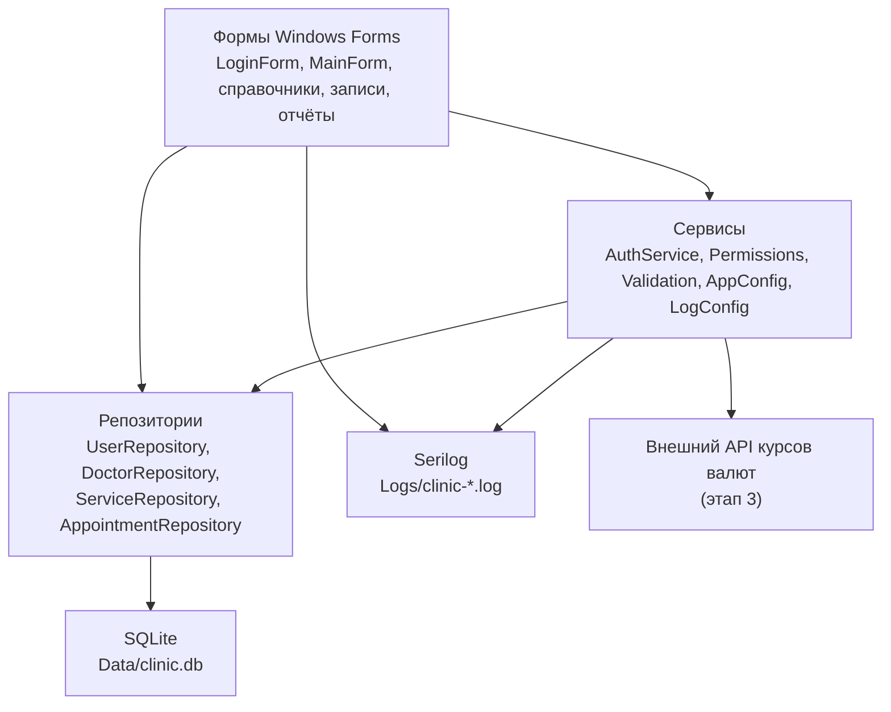
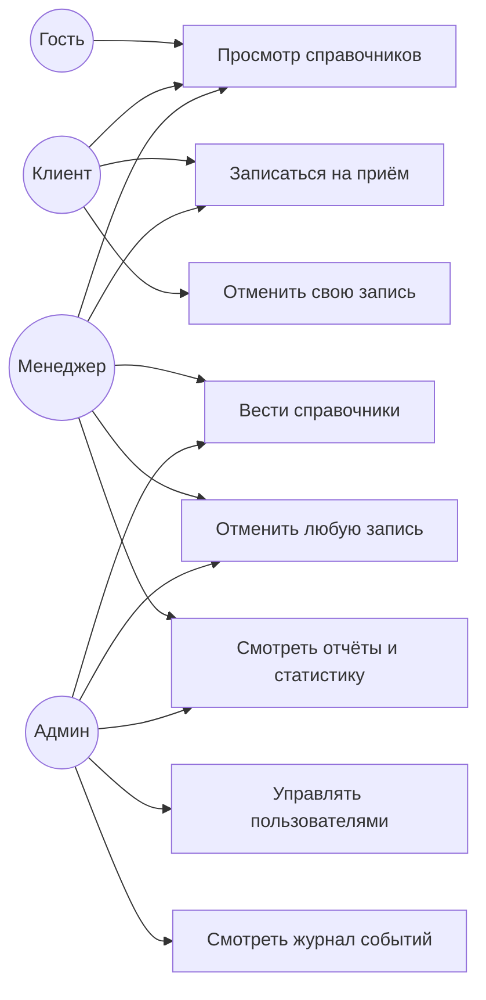
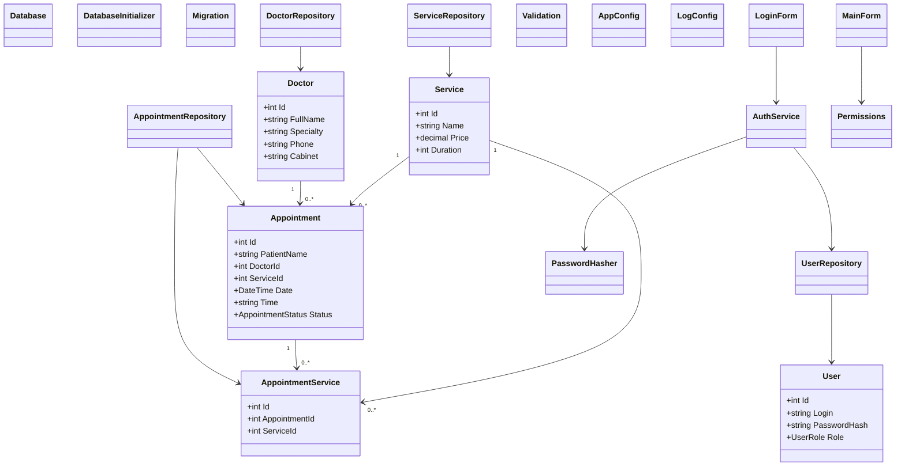
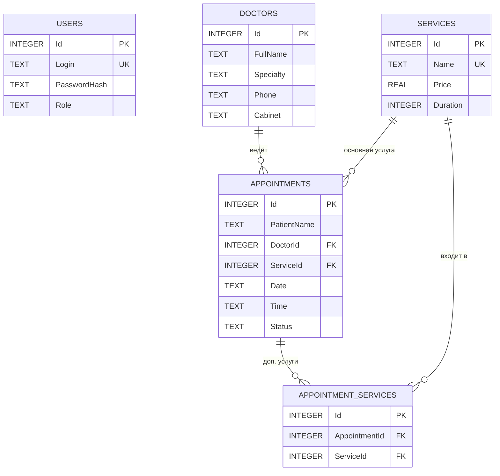

# Отчёт. Этап 1 — проектирование и основа приложения

Материал для переноса в пояснительную записку (оформление по ГОСТ 19.201-78 / 19.402-78).

## Введение

**Актуальность.** Запись на приём в медицинской клинике традиционно ведётся в бумажном
журнале или в разрозненных таблицах. Это приводит к накладкам (два пациента на одно время),
потере данных и невозможности быстро получить статистику загрузки врачей. Программа
«Система записи на приём» автоматизирует ведение справочников, записей и отчётности,
разграничивает доступ сотрудников по ролям и ведёт журнал действий.

**Цель работы** — разработать настольное приложение для автоматизации записи пациентов
на приём в медицинской клинике.

**Задачи:**

1. Спроектировать схему базы данных в третьей нормальной форме (3НФ).
2. Реализовать модели данных, репозитории и миграции схемы.
3. Реализовать авторизацию с хранением паролей в виде хэша SHA256.
4. Реализовать разграничение прав по четырём ролям.
5. Обеспечить журналирование событий (Serilog) и внешнюю конфигурацию.
6. Подготовить каркас главного окна с меню и вкладками.
7. (Этап 2) Реализовать справочники, запись на приём, фильтры, пагинацию, статистику.
8. (Этап 3) Реализовать отчёты, экспорт в Excel, графики, тесты, документацию.

**Стек технологий:** C# 7.3, Windows Forms, .NET Framework 4.7.2 (поддержка Windows 7 SP1),
SQLite (файловая СУБД), Dapper (микро-ORM), Serilog (журналирование),
Newtonsoft.Json (конфигурация). На этапе 3 добавляются EPPlus, ScottPlot, xUnit.

## 1. Проектирование

### 1.1. Требования к программе (сокращённо по ГОСТ 19.201-78)

**Назначение.** Автоматизация записи пациентов на приём и ведения справочников клиники.

**Требования к функциональным характеристикам:**

- авторизация по логину и паролю; пароль хранится только в виде хэша SHA256;
- четыре роли: гость, клиент, менеджер, админ; интерфейс и команды зависят от роли;
- ведение справочников врачей и услуг (просмотр, поиск, добавление, изменение, удаление);
- создание записи на приём: пациент, врач, одна или несколько услуг, дата, время;
- статусы записи: «записан», «отменён», «завершён»;
- фильтрация записей по дате и врачу, сортировка, постраничный вывод;
- запрет удаления врача/услуги, если на них ссылаются записи (ссылочная целостность);
- статистика: среднее число записей в день, медиана, дисперсия;
- отчёт «Записи за период» и экспорт в Excel;
- график статистики; запрос курсов валют по HTTP;
- журналирование всех значимых действий.

**Требования к надёжности.** Все операции записи в БД выполняются в транзакциях;
ошибки перехватываются и показываются пользователю понятным текстом, технические
подробности пишутся в журнал.

**Условия эксплуатации.** ПК с Windows 7 SP1/10/11, .NET Framework 4.7.2,
свободное место под файл БД и журналы.

### 1.2. Структурная схема



### 1.3. UML use case (варианты использования)



### 1.4. Матрица прав

| Возможность | Гость | Клиент | Менеджер | Админ |
|---|---|---|---|---|
| Просмотр справочников | + | + | + | + |
| Создание записи | − | + | + | + |
| Отмена своей записи | − | + | + | + |
| Отмена любой записи | − | − | + | + |
| Добавление/изменение справочников | − | − | + | + |
| Удаление из справочников | − | − | − | + |
| Отчёты и статистика | − | − | + | + |
| Управление пользователями | − | − | − | + |
| Журнал событий | − | − | − | + |

### 1.5. UML диаграмма классов (основные классы)



### 1.6. ER-диаграмма



Соответствие 3НФ: в каждой таблице есть первичный ключ; неключевые атрибуты зависят
только от ключа целиком (нет частичных и транзитивных зависимостей); справочники
врачей и услуг вынесены отдельно, а связь «запись — услуга» реализована таблицей связи
`AppointmentServices` (устранено дублирование названий услуг в записях).

### 1.7. Правила ссылочной целостности

| Правило | Реализация |
|---|---|
| Нельзя создать запись для несуществующего врача/услуги | `FOREIGN KEY (DoctorId) REFERENCES Doctors(Id)` |
| Нельзя удалить врача, у которого есть записи | `ON DELETE RESTRICT` + проверка `DoctorRepository.CountAppointments` |
| Нельзя удалить услугу, используемую в записи | `ON DELETE RESTRICT` + проверка `ServiceRepository.CountUsage` |
| При удалении записи её доп. услуги удаляются автоматически | `ON DELETE CASCADE` в `AppointmentServices` |
| Логин уникален без учёта регистра | `Login TEXT NOT NULL COLLATE NOCASE UNIQUE` |
| Название услуги уникально | `Name TEXT NOT NULL UNIQUE` |
| Статус и роль — только из допустимого набора | `CHECK (Status IN (...))`, `CHECK (Role IN (...))` |
| Проверка внешних ключей включена в каждом соединении | `PRAGMA foreign_keys = ON` в `Database.Open()` |

## 2. Разработка — состав модулей

| Модуль | Файл | Назначение |
|---|---|---|
| Точка входа | `Program.cs` | Порядок запуска, цикл «вход → работа → смена пользователя» |
| Подключение | `Data/Database.cs` | Строка подключения SQLite, включение внешних ключей |
| Миграции | `Data/Migrations.cs` | Список версионированных SQL-скриптов |
| Инициализация | `Data/DatabaseInitializer.cs` | Применение миграций, тестовые данные |
| Отображение типов | `Data/SqliteMapping.cs` | Dapper: роль, статус, дата |
| Модели | `Models/*.cs` | POCO-классы таблиц и перечисления |
| Репозитории | `Repositories/*.cs` | SQL-запросы, CRUD, фильтры, пагинация, счётчики |
| Конфигурация | `Services/AppConfig.cs` | Чтение `appsettings.json` |
| Журнал | `Services/LogConfig.cs` | Serilog, файл на каждый день |
| Пароли | `Services/PasswordHasher.cs` | SHA256, сравнение хэшей |
| Авторизация | `Services/AuthService.cs` | Проверка логина/пароля, сообщения об ошибках |
| Права | `Services/Permissions.cs` | Единые правила доступа по ролям |
| Валидация | `Services/Validation.cs` | Проверка ФИО, телефона, цены, времени |
| Подсказки | `UI/PlaceholderHelper.cs` | Текст-подсказка внутри пустого поля |
| Формы | `Forms/*.cs`, `*.Designer.cs` | Вход и главное окно (дизайн в Designer.cs) |

## 3. Схема базы данных (SQL)

```sql
CREATE TABLE Users (
    Id           INTEGER PRIMARY KEY AUTOINCREMENT,
    Login        TEXT    NOT NULL COLLATE NOCASE UNIQUE,
    PasswordHash TEXT    NOT NULL,
    Role         TEXT    NOT NULL CHECK (Role IN ('гость','клиент','менеджер','админ'))
);

CREATE TABLE Doctors (
    Id        INTEGER PRIMARY KEY AUTOINCREMENT,
    FullName  TEXT NOT NULL,
    Specialty TEXT NOT NULL,
    Phone     TEXT,
    Cabinet   TEXT
);

CREATE TABLE Services (
    Id       INTEGER PRIMARY KEY AUTOINCREMENT,
    Name     TEXT    NOT NULL UNIQUE,
    Price    REAL    NOT NULL CHECK (Price >= 0),
    Duration INTEGER NOT NULL CHECK (Duration > 0)
);

CREATE TABLE Appointments (
    Id          INTEGER PRIMARY KEY AUTOINCREMENT,
    PatientName TEXT    NOT NULL,
    DoctorId    INTEGER NOT NULL,
    ServiceId   INTEGER NOT NULL,
    Date        TEXT    NOT NULL,   -- 'гггг-ММ-дд'
    Time        TEXT    NOT NULL,   -- 'ЧЧ:мм'
    Status      TEXT    NOT NULL CHECK (Status IN ('записан','отменён','завершён')),
    FOREIGN KEY (DoctorId)  REFERENCES Doctors(Id)  ON DELETE RESTRICT ON UPDATE CASCADE,
    FOREIGN KEY (ServiceId) REFERENCES Services(Id) ON DELETE RESTRICT ON UPDATE CASCADE
);

CREATE TABLE AppointmentServices (
    Id            INTEGER PRIMARY KEY AUTOINCREMENT,
    AppointmentId INTEGER NOT NULL,
    ServiceId     INTEGER NOT NULL,
    UNIQUE (AppointmentId, ServiceId),
    FOREIGN KEY (AppointmentId) REFERENCES Appointments(Id) ON DELETE CASCADE,
    FOREIGN KEY (ServiceId)     REFERENCES Services(Id)     ON DELETE RESTRICT
);

CREATE TABLE SchemaInfo (
    Version   INTEGER NOT NULL PRIMARY KEY,
    Name      TEXT    NOT NULL,
    AppliedAt TEXT    NOT NULL
);
```

## 4. Результаты тестирования этапа 1

| № | Проверка | Ожидаемый результат | Итог |
|---|---|---|---|
| 1 | Запуск с пустой папкой Data | Файл clinic.db создан, миграции 1–2 применены | ✅ |
| 2 | Вход admin/admin123 | Открывается главное окно, роль «Администратор» | ✅ |
| 3 | Вход client/неверный пароль | Сообщение «Неверный пароль…», запись в журнале | ✅ |
| 4 | Вход с логином из одних пробелов | Сообщение «Введите логин.» | ✅ |
| 5 | Роль «гость» | Нет пунктов «Отчёты», «Администрирование», кнопка записи неактивна | ✅ |
| 6 | Роль «клиент» | Видны справочники и записи, нет отчётов и пользователей | ✅ |
| 7 | Смена пользователя | Возврат к форме входа, запись в журнале | ✅ |
| 8 | Файл журнала | Создан Logs/clinic-ДАТА.log, есть строки входа/ошибок | ✅ |
| 9 | Принудительное удаление врача с записями через репозиторий | `ReferentialIntegrityException` с понятным текстом | ✅ |
| 10 | Подсказка в поле логина | Видна, исчезает при вводе первого символа | ✅ |

## 5. Выводы по этапу

На этапе 1 создан фундамент приложения: спроектирована схема БД в 3НФ, реализованы
модели, репозитории, миграции, авторизация с хэшированием, разграничение ролей,
журналирование и конфигурация. Приложение запускается, создаёт базу, показывает
главное окно с учётом прав пользователя и готово к наполнению разделами этапа 2.
