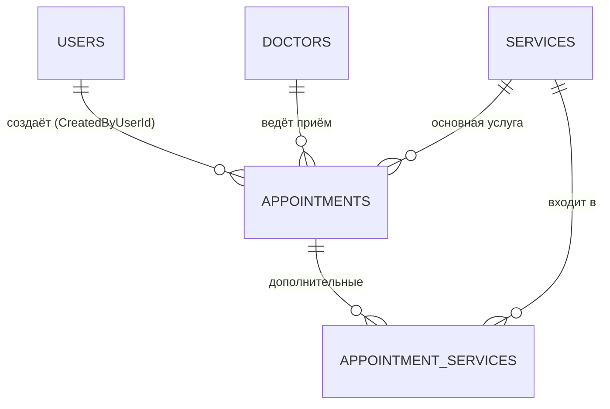

# Отчёт. Этап 2 — справочники, запись на приём и статистика

Материал для переноса в пояснительную записку (оформление по ГОСТ 19.201-78 / 19.402-78).
Продолжение документа `Этап1_отчёт.md`.

## Введение

**Цель этапа** — превратить каркас главного окна в рабочее приложение: научить программу
вести справочники врачей и услуг, записывать пациентов на приём (в том числе на несколько
услуг сразу), отменять и завершать записи, а также считать статистику загрузки клиники.

**Задачи этапа:**

1. Реализовать справочник врачей с поиском, сортировкой, постраничным выводом и CRUD.
2. Реализовать справочник услуг (название, цена, длительность).
3. Реализовать форму записи на приём: пациент, врач, основная и дополнительные услуги,
   дата и время; исключить двойную запись на одно время.
4. Реализовать журнал записей с фильтрами по периоду, врачу и статусу.
5. Реализовать отмену и завершение приёма с проверкой роли и владельца записи.
6. Обеспечить ссылочную целостность при удалении записей справочников.
7. Реализовать расчёт статистики: среднее число записей в день, медиана, дисперсия, СКО.
8. Проверить сборку и поведение модулей на чистой базе данных.

## 1. Состав работ

| Модуль | Файлы | Назначение |
|--------|-------|------------|
| Справочник врачей | `Views/DoctorsView.*`, `Forms/DoctorEditForm.*` | список, поиск, сортировка, пагинация, добавление, изменение, удаление |
| Справочник услуг | `Views/ServicesView.*`, `Forms/ServiceEditForm.*` | то же для услуг с ценой и длительностью |
| Журнал записей | `Views/AppointmentsView.*` | фильтры, сортировка, пагинация, создание, отмена, завершение |
| Форма записи | `Forms/AppointmentEditForm.*` | выбор врача и услуг, дата/время, итоговая стоимость |
| Статистика | `Views/StatisticsView.*`, `Services/StatisticsService.cs` | карточки показателей и разбивка по дням |
| Данные | `Repositories/AppointmentRepository.cs`, `DoctorRepository.cs`, `ServiceRepository.cs` | SQL-запросы, транзакции, проверки |
| Права | `Services/Permissions.cs` | правила ролей в одном месте |
| Схема БД | `Data/Migrations.cs` (миграция 3) | автор записи `CreatedByUserId` |

## 2. Изменение схемы базы данных

На этапе 1 таблица `Appointments` не хранила, кто создал запись. Из-за этого клиент
технически мог отменить чужую запись. Добавлена миграция № 3:

```sql
ALTER TABLE Appointments ADD COLUMN CreatedByUserId INTEGER NULL
    REFERENCES Users(Id) ON DELETE SET NULL;
```

Связи после этапа 2:



Основная услуга хранится в `Appointments.ServiceId`, дополнительные — в таблице связи
`AppointmentServices`. Это позволяет записать пациента сразу на несколько услуг,
не дублируя запись.

## 3. Справочники врачей и услуг

Оба справочника построены по одному шаблону и отличаются только набором полей.

**Поиск.** Строка поиска обрезается по краям и подставляется в `LIKE`:

```sql
SELECT ... FROM Doctors
 WHERE FullName LIKE @q OR Specialty LIKE @q OR Phone LIKE @q OR Cabinet LIKE @q
 ORDER BY <колонка> ASC|DESC
 LIMIT @limit OFFSET @offset;
```

Символы `%` вокруг значения добавляются в параметр, поэтому SQL-инъекция невозможна.

**Сортировка.** Клик по заголовку меняет направление. Имя колонки приходит из интерфейса,
поэтому оно проверяется по «белому списку» (`FullName`, `Specialty`, `Phone`, `Cabinet`).
Неизвестное значение заменяется на сортировку по ФИО.

**Пагинация.** Номер страницы и размер (10/20/50) превращаются в `LIMIT` и `OFFSET`.
Отдельным запросом `COUNT(*)` вычисляется общее число строк, по нему — число страниц.
Если после удаления текущая страница стала лишней, программа автоматически переходит
на последнюю.

**Валидация.** ФИО проверяется на формат «Фамилия Имя Отчество», телефон — по маске
допустимых символов, цена не может быть отрицательной, длительность — от 5 до 480 минут.
Все сообщения об ошибках написаны по-русски и указывают, какое поле исправить.

## 4. Запись на приём

Форма `AppointmentEditForm` содержит:

- поле ФИО пациента с подсказкой внутри поля;
- выпадающий список врачей (ФИО + специальность);
- выпадающий список основной услуги и `CheckedListBox` дополнительных услуг;
- дату (прошедшие дни недоступны) и время с шагом 30 минут с 08:00 до 19:30;
- итоговую строку «цена, длительность», которая пересчитывается при каждом изменении.

Порядок сохранения:

1. Проверка заполненности и формата полей (`Validation`, `AppointmentRepository.CheckAppointment`).
2. Проверка занятости времени у выбранного врача:

```sql
SELECT COUNT(*) FROM Appointments
 WHERE DoctorId = @doctorId AND Date = @date AND Time = @time
   AND Status <> 'отменён';
```

3. Запись основной строки в `Appointments` и дополнительных услуг в `AppointmentServices`
   **в одной транзакции**. Если вставка дополнительных услуг не удалась, отменяется вся запись,
   и «половины» данных в базе не остаётся.
4. Автор записи сохраняется в `CreatedByUserId`.

Таким образом, два пациента не могут попасть на одно время к одному врачу; отменённые
записи время не занимают.

## 5. Журнал записей

Журнал (`AppointmentsView`) показывает дату, время, пациента, врача, услугу и статус.

- **Фильтры:** период «с — по», флажок «Только сегодня», врач (включая «Все врачи») и статус.
- **Сортировка:** по любому заголовку, с повторным кликом — обратный порядок.
- **Пагинация:** 10/20/50 строк, переход вперёд/назад, общее количество записей.
- **Цвета строк:** отменённые — серые, завершённые — светло-зелёные, активные — белые.

Действия и ограничения:

| Действие | Гость | Клиент | Менеджер | Админ |
|----------|:-----:|:------:|:--------:|:-----:|
| Просмотр журнала | да | да | да | да |
| Новая запись | нет | да | да | да |
| Отмена своей записи | нет | да | да | да |
| Отмена любой записи | нет | нет | да | да |
| Завершение приёма | нет | нет | да | да |
| Справочники: добавление/изменение | нет | нет | да | да |
| Справочники: удаление | нет | нет | нет | да |

Проверка «своя запись» выполняется дважды: в интерфейсе (сравнение `CreatedByUserId`
с текущим пользователем) и правилом в репозитории — изменить можно только запись
в статусе «записан». Отменить завершённый приём или завершить отменённый нельзя.

После любого изменения журнал обновляет себя, главная вкладка пересчитывает карточки-счётчики,
а вкладка статистики — показатели.

## 6. Ссылочная целостность

В схеме БД внешние ключи объявлены с `ON DELETE RESTRICT`. Дополнительно репозитории
перед удалением выполняют проверку и выбрасывают `ReferentialIntegrityException`:

```sql
SELECT COUNT(*) FROM Appointments WHERE DoctorId = @id;
```

Если счётчик больше нуля, удаление блокируется, а пользователь видит сообщение:
«Нельзя удалить врача: с ним связано записей на приём — N. Сначала удалите или переназначьте их».
Также проверяется, что врач или услуга вообще выбраны.

## 7. Статистика

Исходные данные — число записей по дням:

```sql
SELECT Date AS Day, COUNT(*) AS Count
  FROM Appointments
 WHERE Date >= @from AND Date <= @to AND Status <> 'отменён'
 GROUP BY Date ORDER BY Date;
```

В расчёт включаются **все календарные дни периода**, в том числе дни без записей
(для них значение равно нулю). Иначе среднее окажется завышенным: пустые дни
просто выпадут из выборки.

Формулы для ряда `x₁ … xₙ` (n — число календарных дней):

- среднее арифметическое: `x̄ = Σxᵢ / n`;
- медиана: середина упорядоченного ряда; при чётном `n` — полусумма двух центральных значений;
- дисперсия (генеральная): `D = Σ(xᵢ − x̄)² / n`;
- среднее квадратическое отклонение: `σ = √D`;
- дополнительно: минимум и максимум за день, число дней с записями.

**Пример.** Период 7 дней, записи: 2, 0, 1, 0, 0, 1, 0.

- сумма = 4, среднее = 4 / 7 ≈ 0,57;
- упорядоченный ряд: 0, 0, 0, 0, 1, 1, 2 → медиана = 0 (четвёртое значение);
- дисперсия ≈ 0,53, σ ≈ 0,73.

(В реальном расчёте значения зависят от данных базы; формулы проверены модульно
и на смоук-тесте.)

Экран статистики показывает карточки «Всего записей», «В среднем за день», «Медиана»,
«Дисперсия», «Отклонение (σ)», строку периода, минимум/максимум и таблицу по дням.

## 8. Тестирование

### 8.1. План тестирования

| № | Проверка | Ожидаемый результат |
|---|----------|---------------------|
| 1 | Запуск на пустой базе | создаются таблицы, 4 пользователя, 6 врачей, 8 услуг, 3 записи |
| 2 | Вход admin/admin123 | роль «Администратор», доступны все вкладки |
| 3 | Поиск врача по части специальности | остаются только подходящие строки |
| 4 | Сортировка кликом по «ФИО» | направление меняется, подпись обновляется |
| 5 | Удаление врача с записями | сообщение о ссылочной целостности, запись не удалена |
| 6 | Создание записи на занятое время | сообщение «Время занято», запись не создаётся |
| 7 | Создание записи с двумя услугами | в базе 1 основная и 1 дополнительная услуга |
| 8 | Отмена своей записи клиентом | статус «Отменён», строка серая |
| 9 | Отмена чужой записи клиентом | запрет с пояснением |
| 10 | Завершение приёма менеджером | статус «Завершён», строка зелёная |
| 11 | Завершение уже завершённой записи | правило репозитория не позволяет |
| 12 | Статистика за 7 дней | среднее, медиана, дисперсия, σ рассчитаны по всем дням |
| 13 | Фильтр «Только сегодня» | даты блокируются, показываются записи за сегодня |
| 14 | Пагинация 10/20/50 | число страниц пересчитывается, кнопки активны по краям |

### 8.2. Результаты

Сборка решения MSBuild: **0 ошибок, 0 предупреждений**.

Автоматический смоук-тест на отдельной копии базы (без риска для рабочей БД) проверил:
создание чистой базы и начальных данных, вход admin, создание записи с двумя услугами,
чтение записи с автором и услугами, определение занятого слота, фильтрацию, статистику,
завершение приёма, запрет отмены завершённой записи, удаление, запрет удаления врача
с записями, а также создание всех экранов (`AppointmentsView`, `StatisticsView`,
`AppointmentEditForm`, `MainForm`). Итог: **SMOKE TEST PASSED**.

### 8.3. Найденный и устранённый дефект

На чистой базе не создавались учётные записи: Dapper при передаче параметра-перечисления
записывает его числом, а в таблице `Users` стоит ограничение `CHECK (Role IN ('гость', …))`.
Поэтому вставка отклонялась, и приложение не могло войти в систему.

Решение:

1. Все операции записи роли и статуса явно переводят перечисление в русский текст
   через `EnumText.RoleToDb` / `EnumText.StatusToDb`.
2. В моделях `User` и `Appointment` добавлены текстовые поля `RoleDb` и `StatusDb`,
   которые Dapper читает напрямую, а свойства `Role` и `Status` переводят их в перечисления.
   Это обходит особенность Dapper, который не применяет `TypeHandler` к enum.
3. Обработчик дат в `SqliteMapping` сохранён, обработчики перечислений удалены
   как неработающие, в коде оставлено пояснение.

После исправления создание базы, вход и все операции с записями проходят успешно.

## 9. Выводы

На этапе 2 приложение стало функционально полным для повседневной работы регистратуры:
справочники ведутся через удобные таблицы с поиском и пагинацией, запись на приём
поддерживает несколько услуг и защищена от накладок по времени, права ролей проверяются
на уровне интерфейса и репозитория, а статистика позволяет оценить загрузку клиники.
Выявленный дефект сопоставления перечислений показал важность проверки на **чистой** базе,
а не только на уже существующей: смоук-тест на отдельной копии БД включён в проверку этапа.

Дальнейшие работы (этап 3): отчёт «Записи за период» с печатной формой, экспорт в Excel,
графики, запрос курсов валют, модульные тесты и руководство пользователя.
